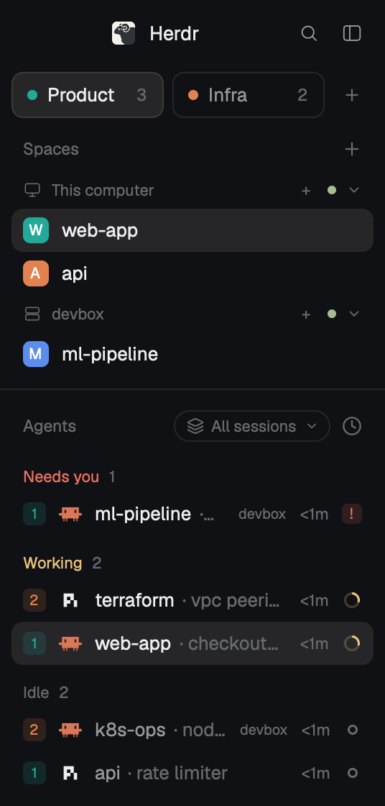

# Herdr Sessions Mod

Sessions for the [Herdr](https://herdr.dev) desktop app: groups of spaces, picked from colored tiles in the sidebar. The agents list filters by session, or shows all sessions with a badge per agent. `hs` (Herdr Sessions CLI) shows and changes it all from a terminal, for you or an agent.

<p align="center"></p>

```
 mods/session-spaces   sidebar: tiles, spaces by session        ┐ shared.json
 mods/session-agents   agents: session filter, badges, grouping ┘ "space.sessions"
 cli/hs.ts             reads shared.json + `herdr-app ls`;
                       writes via `herdr-app do session-spaces.<op>:<json>`
```

## Install

Needs [Bun](https://bun.sh) and the Herdr app.

```sh
bun install
bun run setup      # links mods/* into ~/.config/herdr-app/mods and cli/hs.ts to ~/.local/bin/hs
```

Then use the mods in a layout: `"mod": "session-spaces"` in place of `"spaces"`, and `"mod": "session-agents"` in place of `"agents"`. `bun run teardown` removes the links.

## hs

```
hs                         tree: session › machine › space › agent
hs ls | spaces | agents    lists (--json for agents)
hs find <query>            search spaces and agents
hs add | rm | rename | color | show | move
hs filter all|follow|<s>   agents panel filter
hs sort priority|space|session
```

`hs --help` has the details. Changes need the app open with a layout showing `session-spaces`.

## Develop

`bun test` runs the unit tests; `bun run check` adds `herdr-app check` on both mods. With the links in place, saving a mod file reloads it in the app. [RECIPE.md](RECIPE.md) describes the build.
