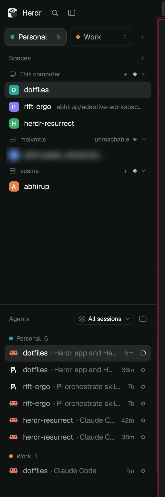

# Herdr Sessions

Sessions are groups of spaces. Colored tiles above the sidebar's space list pick which session's spaces show, still grouped by machine. The agents list below follows the shown session by default, or shows every session's agents with a numbered badge per row. `hs`, a CLI, shows and changes the same sessions for people and agents.

## What you see

- **Session tiles**, between the sidebar's brand row and the "Spaces" header. The row is padded 8px left and 10px right, 4px above and 6px below, with 6px gaps. Each tile is 32px tall with 8px corners and a 1px `border` outline, and the tiles share the row equally: one tile takes half the row, two make wide rectangles, three or four get narrower. A tile shows a 7px dot in the session's color and its name (or its number), semibold, with the space count dim on the right; the count is hidden at zero. The shown tile has a `selected` background. A 26px `+` follows the tiles until there are 4.
- **Rail** (sidebar under 160px): the tiles become a column of 26px rows showing only the number, in the session's color when not shown.
- **Spaces list**: only the shown session's spaces, under their machine headers ("This computer", then the remote machines). Only machines with spaces in the session appear. An empty session lists every machine, each with "New space there".
- **Agents header**: a pill (22px, 11px corners, 1px border) holds a dot in the session's color and the session name, or a layers icon and "All sessions", and a `▾`. Beside it, the sort button.
- **Agent rows**, when every session shows: a 16px badge with 4px corners left of the agent icon, holding the session number in the session's color on a 15%-alpha fill of it.
- **Sort "Grouped by session"**: a header per session (a color dot, the name and the count), sessions in tile order.

## How it behaves

- Click a tile: the list shows that session's spaces, and the main area shows the space last shown in it (else its first).
- Double-click a tile: its name becomes a field. Enter or clicking away saves; an empty name goes back to the number.
- Right-click a tile: a menu with six color swatches (`#22a99a #e3814f #5b8def #8b7cf6 #3fae6a #d9649a`, the space avatars' palette), Rename and Remove session. Remove is off when only one session is left; a removed session's spaces move to the first session.
- Drag a space row onto a tile: the space moves to that session.
- `+`: a new, empty session, shown, with the first unused color.
- A new space joins the shown session. Showing a space some other way (a shortcut, `space.next`) brings the tiles to its session.
- Agents pill: clicking the label switches between the shown session and all sessions. `▾` opens "Show agents from": All sessions or any session. Picking the shown session follows the tiles; picking another one stays put while the tiles change.
- Agent statuses look as in the shipped agents list (spinner working, `!` blocked, done, idle).

## Built from

- `mods/session-spaces`: a copy of the shipped `spaces` mod, plus the tiles, the tile menu (the same mod opened as an `openOverlay` popup with `props.sessionMenu`) and a `nextCommand()` loop for `hs`. `sessions.js` holds the pure session logic.
- `mods/session-agents`: a copy of the shipped `agents` mod, plus the pill and per-row badges, and a third sort option.
- State in `shared("space.sessions")`: `{ list: [{ id, name?, color }], active, of: { spaceId: sessionId }, last: { sessionId: spaceId } }`. `shared("agents.sessions")` is `"follow"`, `"all"` or a session id; `shared("agents.sort")` gains `"session"`.
- `gpui-base`: `InputState`/`Input` (rename), `Button` and `RadioGroup`/`Radio` (menu and swatches), `Toggle` and `Popover` (the pill), `Avatar`/`AvatarFallback` (badges).
- Commands: `space.select`, `space.new`, `space.move`, `layout.resize`.
- `hs` (Bun, `cac`) reads `shared.json` and `herdr-app ls`. It writes only through `herdr-app do 'session-spaces.<op>:<json>'`; the mod answers in `shared("hs.ack")` with the request's `seq`.

## Watch out

- A mod can't import files outside its folder, symlinks included, so `session-agents` reads colors and names from the stored state. That is why every session keeps its color in the state.
- `spaces()` can lack spaces while the app starts or a machine is away. Keep their mapping; dropping it would move every space to the shown session on each restart.
- Picking a session sets the state before `space.select` lands, so the tiles may only follow the shown space when it changes, not on every render.
- Focus a new `Input` on a timer after it is drawn; focusing it in the same press fails. The second press of a double-click must not also pick the tile.
- Edits to the shipped `spaces`/`agents` don't carry over: these are copies, and layouts must name them.
- At most 4 sessions.

## Done when

- `herdr-app check` passes for both mods and `bun test` passes.
- Two sessions show as two equal tiles; clicking each swaps the spaces list and the shown space.
- A new space made while session 2 shows appears only under session 2.
- Rename, color and Remove from the tile menu change the tile and the agents pill.
- The pill set to All sessions shows a badge per agent and stays that way while the tiles change.
- `hs`, `hs ls --json` and `hs agents` match the sidebar; `hs add X --no-show`, `hs rename`, `hs color`, `hs move` and `hs rm` show up in the sidebar at once.
